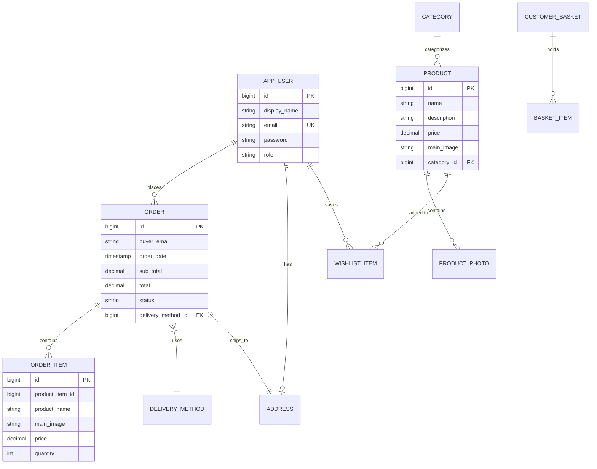

<div align="center">

# 🛍️ Modern Full-Stack E-Commerce Platform

### Enterprise-grade, reactive e-commerce solution engineered with **Spring Boot 3 (Java 21)** and **Angular**

[](https://openjdk.org/)
[](https://spring.io/projects/spring-boot)
[](https://angular.dev/)
[](https://www.typescriptlang.org/)
[](https://spring.io/projects/spring-security)
[](https://getbootstrap.com/)
[](https://www.postgresql.org/)
[](LICENSE)

<br/>

[Key Features](#-key-features) •
[Architecture](#-system-architecture) •
[API Reference](#-api-endpoints-reference) •
[Database Model](#-database-schema) •
[Getting Started](#-getting-started) •
[Demo Credentials](#-demo-accounts)

</div>

---

## 📌 Overview

This project is a complete, production-ready, full-stack E-Commerce platform built from the ground up following clean architecture and modern software engineering best practices. It delivers a fast, responsive, and secure shopping experience with seamless communication between a **Spring Boot 3** REST API backend and a reactive **Angular** frontend.

The application incorporates enterprise patterns including stateless JWT authentication, repository/service decoupling, comprehensive DTO mappings, reactive state management using RxJS observables, centralized error and loading interceptors, and robust automated database seeding.

---

## ✨ Key Features

### 🛍️ Product Catalog & Smart Filtering
- **Dynamic Search & Pagination:** Server-side pagination with configurable page size, real-time keyword search, and item count indicators.
- **Multi-Criteria Filtering:** Filter products by categories with active filter state management.
- **Flexible Sorting:** Sort by Price (Ascending/Descending) or Alphabetical order.
- **Product Details:** High-resolution product images, stock status, full description, and direct add-to-cart controls.

### 🛒 Shopping Cart (Basket)
- **Persistent State:** Dual-layer basket management synchronized across local storage and backend persistence.
- **Quantity Adjustments:** Real-time quantity increment/decrement and instant subtotal re-calculation.
- **Live Navbar Counter:** Dynamic badge counter reflecting total cart quantity in real-time.

### 💳 Seamless Checkout & Order Lifecycle
- **Multi-Step Checkout:**
  - **Step 1 - Shipping Address:** Pre-populated automatically from saved user profile or manually editable.
  - **Step 2 - Delivery Method:** Choice between Standard, Express, and Next-Day delivery with live shipping fee calculation.
  - **Step 3 - Order Review:** Real-time financial summary displaying subtotal, delivery fees, and order total.
- **Order Placement Safety:** Prevents duplicate submissions and cleans up the basket upon order completion.
- **Order Confirmation Page:** Instant transition to order receipt featuring order number, status badge, full item breakdown, delivery address, and action buttons.

### 📦 Order History & Tracking
- **User Order Dashboard:** Complete historical ledger of past purchases with creation date, status, and total paid.
- **Order Details View:** Detailed invoice view containing every purchased product, shipping address, chosen delivery tier, and payment summary.

### ❤️ Wishlist System
- **Save For Later:** Instant one-click wishlist toggling from product cards or product details.
- **Navbar Live Counter:** Reactive badge counter displaying saved item count.
- **Direct Move to Cart:** Add wishlisted products directly to the shopping cart.

### 👤 Authentication & User Profile
- **Stateless JWT Security:** Industry-standard JWT tokens delivered via HTTP-only cookies and Bearer headers for maximum security against XSS.
- **Profile Management:** Manage personal profile information and save default shipping addresses for fast 1-click checkout.
- **Role-Based Access Control:** Distinct roles (`ROLE_USER` and `ROLE_ADMIN`) with route protection via Angular functional guards (`authGuard`).

---

## 🏗️ System Architecture

The project follows a **Layered Clean Architecture** that enforces strict separation of concerns:

```
┌────────────────────────────────────────────────────────┐
│               Angular Frontend (Client)                │
│  Components ──► Services ──► Interceptors (JWT, Error) │
└───────────────────────────┬────────────────────────────┘
                            │ HTTP / JSON (REST APIs)
┌───────────────────────────▼────────────────────────────┐
│              Spring Boot Backend (Server)              │
│  Controllers ──► DTOs ──► Services ──► Repositories    │
│                            │                           │
│                   Spring Security (JWT)                │
└───────────────────────────┬────────────────────────────┘
                            │ Spring Data JPA / Hibernate
┌───────────────────────────▼────────────────────────────┐
│             Database (H2 File / PostgreSQL)            │
└────────────────────────────────────────────────────────┘
```

### Backend Design Patterns & Highlights:
- **Controller-Service-Repository Pattern:** Controllers remain thin, focusing solely on HTTP request validation and status code mapping. Business logic is strictly encapsulated in Services.
- **DTO Encapsulation:** Strict separation between database JPA Entities and API Request/Response DTOs to prevent over-posting and protect sensitive fields.
- **Stateless Authentication:** Spring Security 6 configured with `SessionCreationPolicy.STATELESS` and custom `JwtAuthenticationFilter`.
- **Global Error Handling:** `@RestControllerAdvice` providing consistent RFC 7807-compliant JSON error responses for `400 Bad Request`, `401 Unauthorized`, `404 Not Found`, and `500 Internal Error`.
- **Static Asset Serving:** Custom resource handler mapping `/images/**` to serve product photos with URL encoding and fallback handling.

### Frontend Design Patterns & Highlights:
- **Reactive State Management:** Centralized state managed via RxJS `BehaviorSubject` for the Cart, User Identity, and Wishlist badge counter.
- **HTTP Interceptors:**
  - `JwtInterceptor`: Automatically attaches JWT bearer tokens and enables credentials for all outgoing requests.
  - `ErrorInterceptor`: Catches HTTP errors globally, displaying toast alerts via `ngx-toastr` and redirecting expired sessions to Login.
  - `LoaderInterceptor`: Displays a seamless loading spinner during background asynchronous operations.
- **Functional Route Guards:** Angular functional `authGuard` protecting checkout, orders, wishlist, and profile routes.

---

## 🗄️ Database Schema



---

## 🔌 API Endpoints Reference

### 🔐 Authentication & Identity (`/api/Account`)
| Method | Endpoint | Description | Auth Required |
|---|---|---|---|
| `POST` | `/api/Account/Login` | Authenticate user, return JWT token & set cookie | ❌ Public |
| `POST` | `/api/Account/Register` | Register a new user account | ❌ Public |
| `GET` | `/api/Account/current-user` | Retrieve authenticated user profile | 🔒 Bearer Token |
| `POST` | `/api/Account/Logout` | Invalidate session / clear auth cookie | 🔒 Bearer Token |

### 📦 Products & Categories
| Method | Endpoint | Description | Auth Required |
|---|---|---|---|
| `GET` | `/api/Products` | Get paginated products with search, sort & category filters | ❌ Public |
| `GET` | `/api/Products/{id}` | Get detailed product information | ❌ Public |
| `GET` | `/api/Categories` | List all available product categories | ❌ Public |
| `GET` | `/api/Categories/{id}` | Get category by ID | ❌ Public |

### 🛒 Shopping Cart (`/api/Basket`)
| Method | Endpoint | Description | Auth Required |
|---|---|---|---|
| `GET` | `/api/Basket/{id}` | Retrieve customer basket by UUID | ❌ Public |
| `POST` | `/api/Basket` | Create or update customer basket | ❌ Public |
| `DELETE` | `/api/Basket/{id}` | Clear basket by UUID | ❌ Public |

### 💳 Orders & Checkout (`/api/Orders`)
| Method | Endpoint | Description | Auth Required |
|---|---|---|---|
| `GET` | `/api/Orders/delivery-methods` | List available delivery tiers (Standard, Express, Next Day) | ❌ Public |
| `POST` | `/api/Orders` *(or `/create`)* | Submit and place a new order | 🔒 Bearer Token |
| `GET` | `/api/Orders` | Retrieve all orders for current user | 🔒 Bearer Token |
| `GET` | `/api/Orders/{id}` | Retrieve specific order details by ID | 🔒 Bearer Token |

### ❤️ Wishlist (`/api/Wishlist`)
| Method | Endpoint | Description | Auth Required |
|---|---|---|---|
| `GET` | `/api/Wishlist` | Retrieve authenticated user's wishlist | 🔒 Bearer Token |
| `POST` | `/api/Wishlist/{productId}` | Add product to wishlist (idempotent) | 🔒 Bearer Token |
| `DELETE` | `/api/Wishlist/{productId}` | Remove product from wishlist | 🔒 Bearer Token |

### 👤 Profile & Address (`/api/profile`)
| Method | Endpoint | Description | Auth Required |
|---|---|---|---|
| `GET` | `/api/profile` | Get user profile info | 🔒 Bearer Token |
| `PUT` | `/api/profile` | Update user display name and profile | 🔒 Bearer Token |
| `GET` | `/api/profile/address` | Get saved shipping address | 🔒 Bearer Token |
| `PUT` | `/api/profile/address` | Update default shipping address | 🔒 Bearer Token |

---

## 💻 Tech Stack

| Domain | Technology | Description |
|---|---|---|
| **Backend** | Java 21 (LTS) | Modern Java featuring enhanced pattern matching & virtual threads |
| **Framework** | Spring Boot 3.3.4 | Micro-framework providing dependency injection and auto-configuration |
| **Security** | Spring Security 6 & JJWT | Stateless JWT authentication, CORS, CSRF, and role authorization |
| **Persistence** | Spring Data JPA / Hibernate | Object-Relational Mapping with custom repository queries |
| **Database** | H2 (Default dev) / PostgreSQL | Lightweight embedded database for dev; PostgreSQL for production |
| **Documentation** | SpringDoc OpenAPI (Swagger UI) | Interactive REST API documentation at `/swagger-ui.html` |
| **Frontend** | Angular 18+ | Component-driven, scalable Single Page Application framework |
| **Styling** | Bootstrap 5.3 & FontAwesome | Responsive mobile-first CSS grid, components, and iconography |
| **Tooling** | Maven 3.9+ & npm | Dependency management and build automation |

---

## 🚀 Getting Started

### Prerequisites
Make sure you have the following installed on your machine:
- **Java Development Kit (JDK 21 LTS)**
- **Apache Maven 3.8+**
- **Node.js (v18 or higher)** & **npm**

### 1. Clone the Repository
```bash
git clone https://github.com/khaledaymansaber/Ecom-SpringBoot-Angular.git
cd Ecom-SpringBoot-Angular
```

### 2. Start the Backend (Spring Boot)
Open a terminal in the `backend/` directory:
```bash
cd backend

# Run with embedded H2 database (zero configuration required, data auto-seeded):
mvn spring-boot:run -Dspring-boot.run.profiles=h2
```
- **Backend API URL:** `http://localhost:8080`
- **Swagger UI Documentation:** `http://localhost:8080/swagger-ui.html`
- **H2 Console:** `http://localhost:8080/h2-console` *(JDBC URL: `jdbc:h2:file:./data/ecomdb`, Username: `sa`, Password: empty)*

### 3. Start the Frontend (Angular)
Open a separate terminal in the `frontend/` directory:
```bash
cd frontend

# Install client dependencies
npm install

# Start the Angular development server
npm start
```
- **Web Application URL:** `http://localhost:4200`

---

## 🔑 Demo Accounts

The application automatically seeds demo users, categories, products, and shipping methods upon first launch:

| Role | Email | Password | Pre-configured Data |
|---|---|---|---|
| **Customer** | `user@ecom.com` | `User@123456` | Has pre-filled shipping address & past orders |
| **Administrator** | `admin@ecom.com` | `Admin@123456` | Full administrative privileges (`ROLE_ADMIN`) |

---

## 📂 Project Structure

```
Ecom-SpringBoot-Angular/
├── .gitignore
├── README.md
├── backend/
│   ├── pom.xml
│   ├── uploads/images/                  # Product image assets
│   └── src/main/java/com/ecom/
│       ├── EcomApplication.java
│       ├── config/                      # SecurityConfig, WebConfig, DataInitializer
│       ├── controller/                  # REST Controllers (Account, Products, Basket, Orders, Wishlist...)
│       ├── dto/                         # Request and Response DTO records/classes
│       ├── entity/                      # JPA Entities (Product, Order, Basket, User, Address...)
│       ├── exception/                   # Global Exception Handler & Custom Exceptions
│       ├── repository/                  # Spring Data JPA Repositories
│       ├── security/                    # JWT Provider, Auth Token Filter, UserPrincipal
│       └── service/                     # Business Logic Layer implementations
│
└── frontend/
    ├── package.json
    ├── angular.json
    └── src/app/
        ├── basket/                      # Cart component, summary, and BasketService
        ├── checkout/                    # Multi-step checkout with address & delivery selection
        ├── core/                        # Interceptors (JWT, Error, Loader), Guards, Navbar
        ├── home/                        # Landing page with featured deals & category highlights
        ├── identity/                    # Authentication (Login, Register, Password Reset)
        ├── orders/                      # Order History dashboard & Order Details views
        ├── profile/                     # User Profile details & Address management
        ├── shared/                      # Reusable components (pagination, models, order total)
        ├── shop/                        # Product Catalog, filtering, sorting, product details
        └── wishlist/                    # Wishlist management component & WishlistService
```

---

## 👨‍💻 Author

**Khaled Ayman Saber**
- **GitHub:** [@khaledaymansaber](https://github.com/khaledaymansaber)
- **Email:** khaledaymansaber@gmail.com

---

## 📄 License

This project is licensed under the [MIT License](LICENSE) - feel free to use, modify, and distribute for personal or commercial projects.
